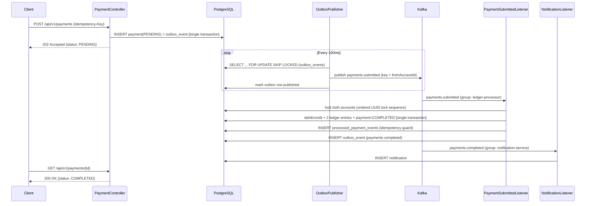

# PayCore

**High-Throughput Distributed Payment Processing & Double-Entry Ledger Engine**

PayCore is an event-driven payment processing and double-entry ledger platform engineered for financial correctness, high throughput, and fault tolerance under concurrent load. Built with Spring Boot 3, Apache Kafka, PostgreSQL, and Redis, PayCore decouples synchronous payment submission from asynchronous background settlement using the Transactional Outbox pattern.

Submitting a payment is a fast, synchronous API call returning `202 Accepted` within milliseconds. Actual fund movement occurs asynchronously via Apache Kafka consumer groups that enforce atomic double-entry bookkeeping, deadlock-free account locking, and distributed idempotency guarantees.

---

## Technology Stack

- **Backend Platform:** Java 21, Spring Boot 3.3.4 (Spring Web, Spring Data JPA, Spring Kafka, Spring Validation, Spring Actuator)
- **Event Streaming:** Apache Kafka 3.7.1 (KRaft mode, no ZooKeeper required)
- **Database & Persistence:** PostgreSQL 16, Hibernate 6, Flyway Database Migrations
- **Cache & Idempotency Store:** Redis 7
- **API Documentation:** OpenAPI 3 / Swagger UI (SpringDoc 2.6.0)
- **Testing & Verification:** JUnit 5, Mockito, Testcontainers (PostgreSQL, Kafka), Awaitility
- **Load Testing & Infrastructure:** k6, Docker Compose, Kafka UI
- **Frontend Dashboard:** React 18, Vite (lightweight single-page monitoring UI)

---

## Core Features

- **Decoupled Asynchronous Settlement:** `POST /api/v1/payments` durably records payments as `PENDING` alongside an outbox event in a single fast local database transaction, immediately returning `202 Accepted`.
- **Double-Entry Bookkeeping:** All balance transfers generate matching, balanced debit and credit `LedgerEntry` records atomically within the database transaction.
- **Deadlock-Free Concurrency Control:** When transferring funds between two accounts, accounts are locked using pessimistic locking (`SELECT ... FOR UPDATE`) sorted in consistent alphabetical order by account UUID, eliminating deadlocks under concurrent bidirectional traffic.
- **End-to-End Idempotency:** Payment submission is guarded by Redis-backed idempotency caching (`Idempotency-Key` header with 24-hour TTL). Asynchronous consumer delivery is further guarded against duplicate execution via the `processed_payment_events` table.
- **Transactional Outbox Pattern:** Application state changes and domain events are persisted in the same PostgreSQL transaction. A scheduled publisher polls unpublished records and emits them to Kafka, guaranteeing at-least-once delivery without dual-write vulnerabilities.
- **Per-Account Partition Ordering:** Kafka messages are keyed by `fromAccountId`, ensuring transactions for any given account are processed chronologically in submission order without serializing unrelated accounts.
- **Decoupled Notification Consumer:** An independent Kafka consumer group (`notification-service`) subscribes to completion and failure events to simulate downstream audit and alerting without impacting settlement throughput.
- **Live Monitoring Dashboard:** A React + Vite dashboard (`frontend/`) visualizes accounts, balances, ledger entries, and real-time payment settlement (`PENDING` → `COMPLETED` / `FAILED`).

---

## Architecture & Request Flow

See [`docs/architecture.md`](docs/architecture.md) for full design rationale and sequence diagrams.



---

## Architectural Decisions & Interview Highlights

- **Transactional Outbox vs. Direct Kafka Publishing:** Writing to PostgreSQL and publishing to Kafka cannot execute as a single distributed atomic transaction. Publishing directly from the HTTP request thread risks dual-write anomalies (e.g. database commits, but server crashes before Kafka publish, leaving payment stuck). The Outbox pattern guarantees that any committed payment produces an outbox event that will be published upon poller recovery.
- **Pessimistic Locking with Ordered Locks vs. Optimistic Locking:** Under high concurrency, hot accounts experience high contention. Optimistic locking (`@Version`) causes frequent rollbacks and retries, wasting computational resources. Pessimistic locking (`SELECT ... FOR UPDATE`) combined with deterministic lock acquisition ordering (sorting account IDs before locking) prevents race conditions and eliminates deadlocks entirely.
- **Source Account Partition Keying:** Kafka guarantees partition-level message ordering. Keying `payments.submitted` by `fromAccountId` ensures a given account's debits are processed in strict order without requiring a single global partition bottleneck.

---

## Prerequisites

- **Java Development Kit:** Java 21 LTS
- **Build Tool:** Apache Maven 3.9+
- **Container Runtime:** Docker & Docker Compose
- **Node.js & npm** (optional, for frontend UI): Node 18+
- **k6** (optional, for load testing): [k6.io](https://k6.io/)

---

## Getting Started

### 1. Start Infrastructure Services

Start PostgreSQL, Kafka (KRaft mode), Redis, and Kafka UI in the background:

```bash
docker compose up -d
```

Verify that containers are healthy:
```bash
docker compose ps
```

### 2. Build and Run the Application

Flyway migrations execute automatically on application startup to initialize the schema:

```bash
mvn spring-boot:run
```

The application starts on port `8080`.

### 3. Service Access Points

- **REST API:** `http://localhost:8080`
- **Interactive Swagger UI:** `http://localhost:8080/swagger-ui.html`
- **OpenAPI JSON Spec:** `http://localhost:8080/v3/api-docs`
- **Kafka UI Console:** `http://localhost:8081`
- **Actuator Health Check:** `http://localhost:8080/actuator/health`

---

## Quickstart & API Walkthrough

### Create Accounts

```bash
# Create Account for Alice
ALICE=$(curl -s -X POST http://localhost:8080/api/v1/accounts \
  -H 'Content-Type: application/json' \
  -d '{"ownerName":"Alice","currency":"USD","initialBalance":500.00}' | jq -r .id)

# Create Account for Bob
BOB=$(curl -s -X POST http://localhost:8080/api/v1/accounts \
  -H 'Content-Type: application/json' \
  -d '{"ownerName":"Bob","currency":"USD","initialBalance":100.00}' | jq -r .id)
```

### Submit a Payment

```bash
IDEMPOTENCY_KEY=$(uuidgen 2>/dev/null || powershell -Command "[guid]::NewGuid().ToString()")

curl -i -s -X POST http://localhost:8080/api/v1/payments \
  -H 'Content-Type: application/json' \
  -H "Idempotency-Key: $IDEMPOTENCY_KEY" \
  -d "{\"fromAccountId\":\"$ALICE\",\"toAccountId\":\"$BOB\",\"amount\":75.00,\"currency\":\"USD\"}"
```

Returns `HTTP/1.1 202 Accepted` with payload containing payment ID and status `PENDING`.

### Poll Payment Status

Within a few hundred milliseconds, the background Kafka consumer settles the transaction:

```bash
curl -s http://localhost:8080/api/v1/payments/<PAYMENT_ID>
```

Status transitions to `COMPLETED`.

### Inspect Account Ledger

```bash
curl -s "http://localhost:8080/api/v1/accounts/$ALICE/ledger"
```

Displays debit and credit journal entries with balances and timestamps.

---

## Frontend Dashboard

A lightweight React + Vite dashboard is available in [`frontend/`](frontend/):

```bash
cd frontend
npm install
npm run dev
```

Open `http://localhost:5173` to interactively create accounts, trigger transfers, and watch transactions settle in real time.

---

## Testing

### Unit Tests

Unit tests verify service logic, idempotency, lock ordering, and error conditions using Mockito:

```bash
mvn test -Dtest="*ServiceTest"
```

### Integration Tests & Verification

Runs all unit tests plus the Testcontainers integration suite (`PaymentFlowIntegrationTest`), validating the end-to-end HTTP → Outbox → Kafka → Consumer → Double-Entry Ledger pipeline against containerized PostgreSQL and Kafka:

```bash
mvn clean verify
```

Continuous Integration runs `mvn clean verify` on every push via [GitHub Actions](.github/workflows/ci.yml).

---

## Benchmark & Load Testing

Load testing is configured with [k6](loadtest/README.md) using constant-arrival-rate execution:

```bash
# Seed 50 accounts
./loadtest/seed-accounts.sh 50

# Execute benchmark
k6 run loadtest/submit-payments.js
```

### Verified Benchmark Results

Measured with `k6 run loadtest/submit-payments.js` (50 seeded accounts, constant-arrival-rate at 60 req/s for 2 minutes):

| Metric | Result |
|---|---|
| **Sustained Throughput** | **3,600 transactions/min** (7,200 requests in 120.0s) |
| **p95 Submission Latency** | **12.6 ms** |
| **Failed Request Rate** | **0.00%** |
| **Configuration** | `RATE=60`, `DURATION=2m`, 50 seeded accounts |

*Environment: MacBook Air (Apple Silicon), Docker Desktop, local Postgres, Kafka, Redis, and app containers.*

Submission latency remains consistently low because `POST /api/v1/payments` only writes a local pending record and outbox entry before returning, offloading ledger settlement to asynchronous consumers.

---

## Project Structure

```
paycore/
├── pom.xml                               # Maven project configuration (Java 21, Spring Boot 3.3.4)
├── docker-compose.yml                    # Local infrastructure (Postgres, Kafka KRaft, Redis, Kafka UI)
├── docs/
│   └── architecture.md                   # System design, request flow, and concurrency details
├── frontend/                             # React + Vite visual monitoring dashboard
├── loadtest/
│   ├── seed-accounts.sh                  # Account seeding script
│   └── submit-payments.js                # k6 load test script
└── src/
    ├── main/
    │   ├── java/com/paycore/paymentledger/
    │   │   ├── PaymentLedgerApplication.java # Spring Boot main entry point
    │   │   ├── api/                          # REST controllers, DTOs, global exception handling
    │   │   ├── config/                       # Kafka, Redis, Web, OpenAPI, and app configuration
    │   │   ├── domain/                       # JPA entities (Account, Payment, LedgerEntry, OutboxEvent)
    │   │   ├── exception/                    # Domain-specific business exceptions
    │   │   ├── kafka/                        # Outbox publisher, event listeners, event payloads
    │   │   ├── repository/                   # Spring Data repositories with pessimistic lock queries
    │   │   └── service/                      # Core business services (payment, ledger, idempotency)
    │   └── resources/
    │       ├── application.yml               # Application configuration and logging
    │       └── db/migration/                 # Flyway SQL migrations and seed data
    └── test/
        └── java/com/paycore/paymentledger/
            ├── integration/                  # Testcontainers integration tests (full flow)
            └── service/                      # Mockito unit tests (processing, idempotency)
```
